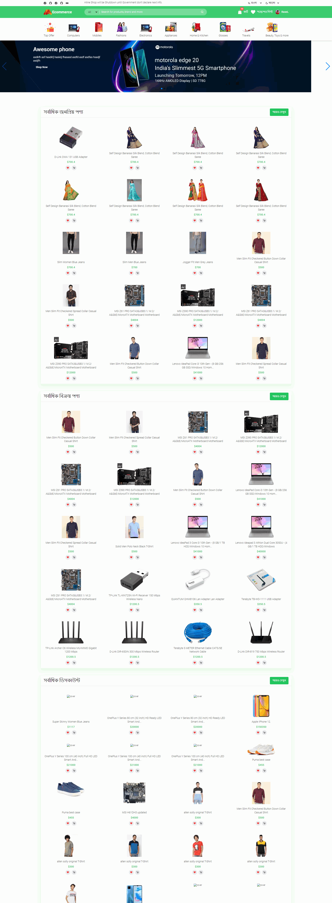
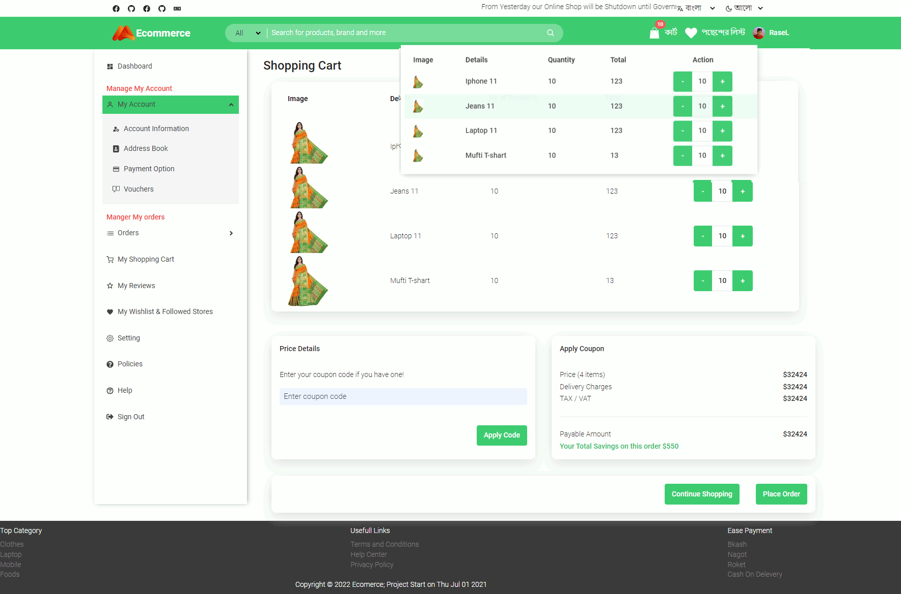
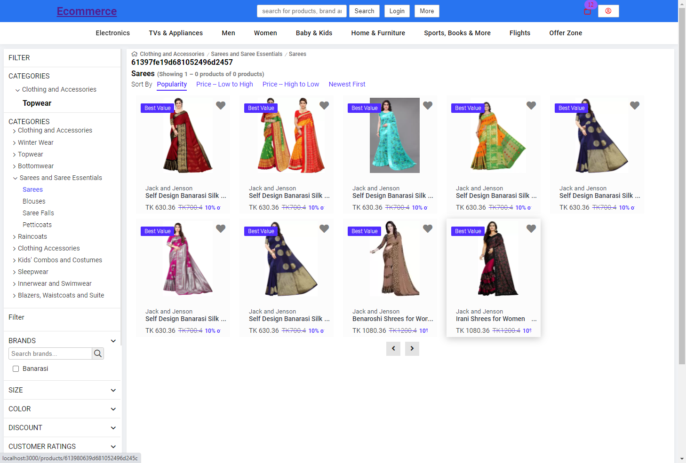

# Dream Bajar Multi-Product Ecommerce Application 

Dream Bajar is Multi-Product and Vendor Ecommerce website, build with Nodejs, React js and Mongodb

Project Directory
- client [client side]
- client/public/static [static directory for development mode]`

- server [server side]
- server/public/static [static directory and client bundle for production mode]


### This Application under development

Live Link [upcoming preview]()


## Application Features
- Multiple language system ( currently bangla and english)
- Dark and light mode system.
- Social Facebook, Google and Password based Authentication using passport and jwt.
- Reset password via sending email using nodemailer
- Multiple Category system
- Multiple vendor system. also multiple store for seller.
- Customer Dashboard. customer manage their order, payment, shipping addresses, cart item and profile.
- Admin Dashboard. admin can manage product, brands, category etc 
  like added, update, delete. manage customer orders, order cancellation


### I build a lot of reusable ui components. To avoid extra UI library component 

## Technology used
- React18
- Typescript
- Redux, react-redux (for manage state) 
- React-router-dom6 (Route base code spliting)
- React-context-api + useReducer (mange some state)
- Tailwindcss
- swiper (for product slider)
- Sass
- Expressjs
- Mongodb(native)
- sqlite(SQL database) for manage categories and brands
- formidable
- bcryptjs for password hashing
- jsonwebtoken
- passportjs
- Docker & Docker Compose

## Docker & Docker Compose Setup

This project is fully containerized using Docker and Docker Compose, orchestrating the Frontend, Backend, MongoDB database, and Mongo Express management interface.

### Services Overview

| Service | Technology | Port (Host:Container) | Description |
| :--- | :--- | :--- | :--- |
| **client** | React 18 / Vite / Tailwind | `3000:7000` | Frontend web client (hot-reloading enabled) |
| **server** | Node.js / Express / TypeScript | `4000:4000` | REST API backend (hot-reloading with ts-node-dev) |
| **mongodb** | MongoDB 7.0 | `27017:27017` | Persistent NoSQL database with volume storage |
| **mongo-express** | Mongo Express | `8081:8081` | Web-based administration GUI for MongoDB |

> **Note for macOS users**: Port `3000` is mapped on the host to avoid port 7000 collisions with Apple's AirPlay Receiver. Custom ports can be set in `.env`.

### Quick Start (Development)

1. **Clone and enter the directory**:
   ```bash
   cd dream-bazar-frontend
   ```

2. **Copy environment file** (optional, defaults are pre-configured):
   ```bash
   cp .env.example .env
   ```

3. **Start all services**:
   ```bash
   docker compose up -d --build
   ```

4. **Access the application**:
   - **Frontend Client**: [http://localhost:3000](http://localhost:3000)
   - **Backend API**: [http://localhost:4000](http://localhost:4000)
   - **API Health Check**: [http://localhost:4000/health](http://localhost:4000/health)
   - **Mongo Express UI**: [http://localhost:8081](http://localhost:8081)
   - **Direct MongoDB Connection**: `mongodb://localhost:27017/dream-bazar`

### Common Docker Commands

- **Check status**:
  ```bash
  docker compose ps
  ```

- **Follow logs**:
  ```bash
  docker compose logs -f
  # or specific service:
  docker compose logs -f server
  docker compose logs -f mongodb
  ```

- **Stop containers**:
  ```bash
  docker compose down
  ```

- **Stop containers & remove data volumes**:
  ```bash
  docker compose down -v
  ```

### Production Deployment

To build and run production images (featuring optimized multi-stage builds and Nginx serving the static client bundle):

```bash
docker compose -f docker-compose.prod.yml up -d --build
```

### Preview screenshot

####  Homepage


<br/>

#### Customer Dashboard


<br/>

#### Product Filter Page


<br/>


